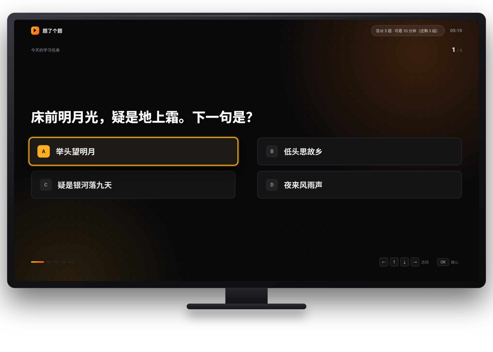
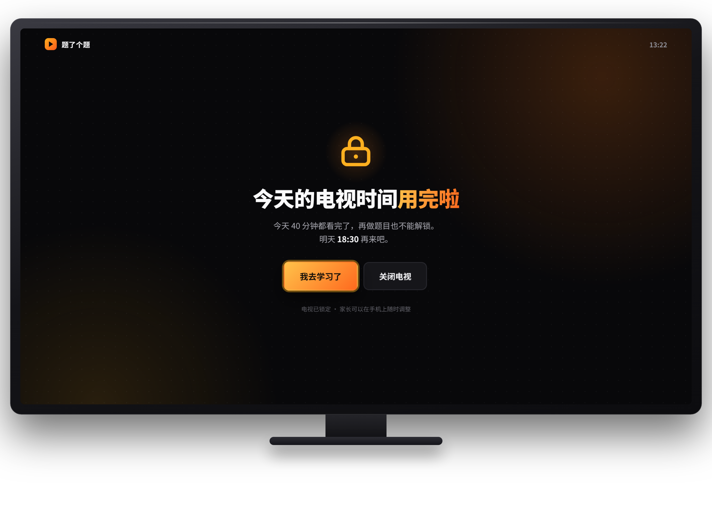
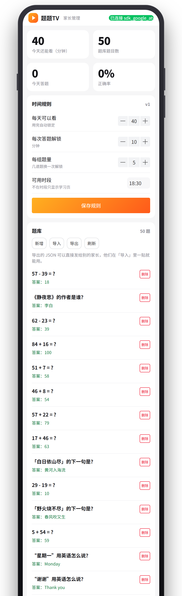
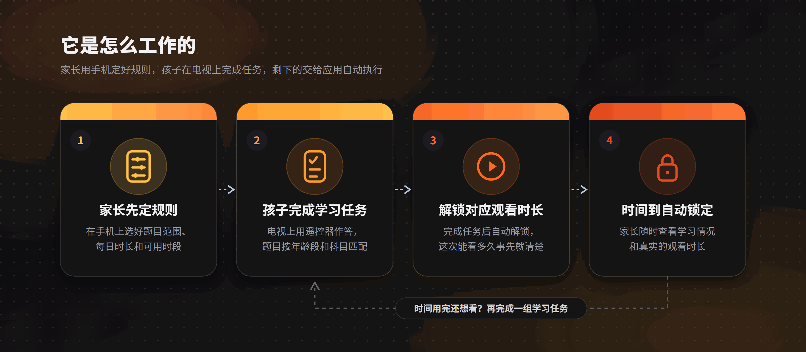

# StudyOnTV

### Learn first. Watch later.

**An open-source Android TV app that turns screen time into something kids earn by learning.**

This project is linked with and endorses the [LINUX DO](https://linux.do) community.

---

## Screenshots

   
  Quiz on the TV — remote-only, no keyboard
    
   
  Lock screen — "do the task again" or "go study", nothing else
    
   
  Parent panel (H5) — rules and records from the phone

## What is StudyOnTV?

StudyOnTV is an open-source **Android TV** app for families with kids aged 3–12. It turns "homework first, TV second" into a rule the app enforces for you:

- **Parents decide the rules from their phone** — which question set (age band and subject), how long the child may watch today, and during which hours.
- **The child completes a short learning task on the TV** using only the remote; answering unlocks the matching amount of watch time.
- **When the time runs out, the screen locks** — parents can see both the learning progress and the real watch time.

> **Learn first. Watch later.**
> Nobody has to take the remote away, and nobody has to be the bad guy every evening.

> **Searching for one of these?**
> Android TV parental control · TV screen time limit · Kids TV lock · Quiz screen lock · Parental control time management — if that is what you are looking for, this is probably it: an **open-source, free** way to manage kids' TV time with rules the app enforces for you.

## Why this exists

Most parental-control tools are punitive: a hard timer, a PIN buried in a settings menu, or pulling the plug. They solve "watch less" but not "does the child accept it" — and kids often find a way around them anyway.

StudyOnTV flips the framing: TV time is not taken away, it is **earned**. The rules are executed by the app instead of by arguments, the child gets a sense of achievement, and the parent stops playing the referee.

## How it works

  

1. **Parents set the rules** — question scope, daily limit, allowed time windows.
2. **The child completes the learning task** — questions matched to their age band and subject.
3. **Watch time is unlocked** — the child knows up front exactly how long this session is.
4. **The screen locks automatically** — and parents can review progress and real watch time.

## What parents can control

| Setting | Description |
|---|---|
| **Question scope** | Choose by age band and subject: early-years cognition and characters, pinyin, mental arithmetic, English vocabulary, general knowledge… |
| **Daily limit** | e.g. 60 minutes a day, enforced by the app — no need to say it out loud |
| **Allowed hours** | TV unlocks only inside the windows you allow (after homework, before 8 pm, …) |
| **Questions per session** | How many questions buy how many minutes |
| **Records** | What was practised, accuracy, and actual watch time |

Changes made on the phone take effect on the TV immediately.

## Status

🧪 **v0.1 beta, recruiting the first families.** The full loop already works end to end: parents set the rules → the child finishes the learning task → watch time unlocks → the screen locks when time is up → parents review progress and records from their phone.

## Features

**Parent side (phone)**
- A question library organised by age band (3–12) and subject, with adjustable difficulty
- Rules for daily limit, allowed hours and questions-per-minute
- Remote updates that apply instantly on the TV
- A clear view of learning progress and real watch time

**Child side (TV)**
- Entirely remote-controlled — no keyboard, no adult help needed
- Helpful hints on a wrong answer instead of a dead end
- Visible progress: minutes earned today, questions completed

**Planned**
- Companion mobile app with live status and "bonus 10 minutes"
- Independent profiles for multiple children
- Weekly learning reports
- Custom question banks uploaded by parents (this week's vocabulary, textbook characters)

## Community

We run a WeChat **beta group** (mainly Chinese-speaking) for parents: the beta build and per-brand setup guides, help with permissions on your specific TV, and a place where feedback shapes the next version. See the QR code in the [Chinese README](./README.md#加入内测群), or open an Issue and we'll help you in.

## Star the repo

⭐ A star is a subscription: you'll see the first release the moment it ships, and it is the signal we use to decide how much more to build. If this is the tool you've been looking for, a star genuinely helps — and helps other parents find it too.

## Contributing

Ideas, question-bank suggestions, bug reports and pull requests are all welcome — see [Issues](https://github.com/chadyi/StudyOnTV/issues). You don't need to be a developer to make this better.

## Keywords

Android TV parental control · TV screen time limit · Kids TV lock · Quiz screen lock · Parental control time management · screen time management for kids · quiz-gated screen time · open-source parental control · smart TV kids lock · Android TV kids mode · educational app for kids · earn screen time by learning

## What is open source?

The **Android TV client** is open source (MIT). The **backend** (question banks, the web UI, the parent panel, records) is hosted by the project for free — you don't need to deploy anything, and updates reach the TV without reinstalling the app.

## Installation guides

Chinese TVs differ a lot from vendor to vendor. We publish step-by-step, screenshot-level guides per brand (Xiaomi, Hisense, TCL, Skyworth, Huawei, Sony Android TV, TV boxes and projectors) covering install, accessibility permission, overlay permission, autostart and keeping the guard service alive.

## License

MIT
