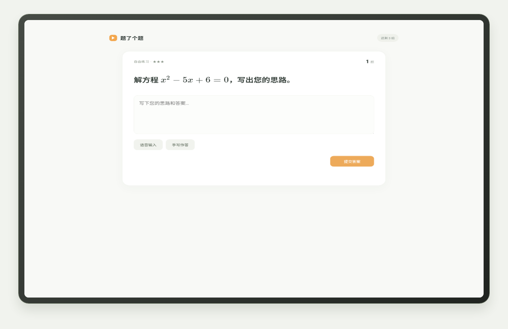
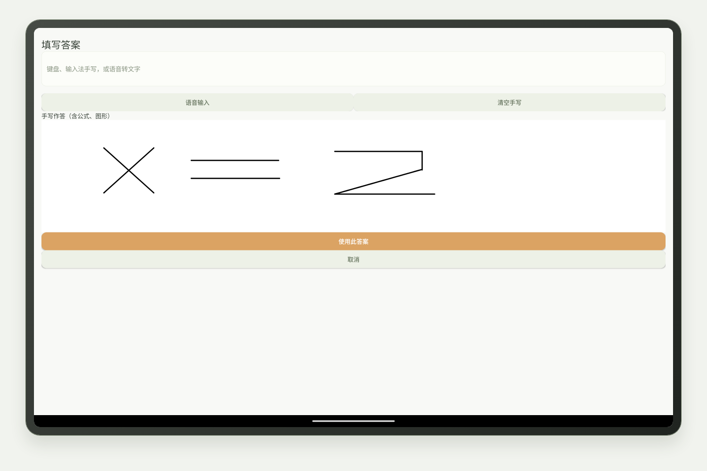
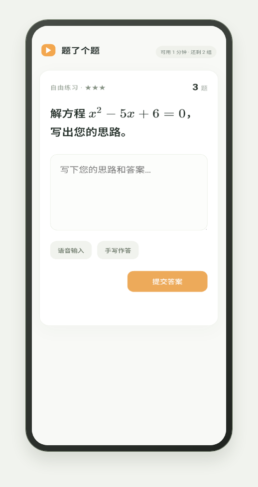
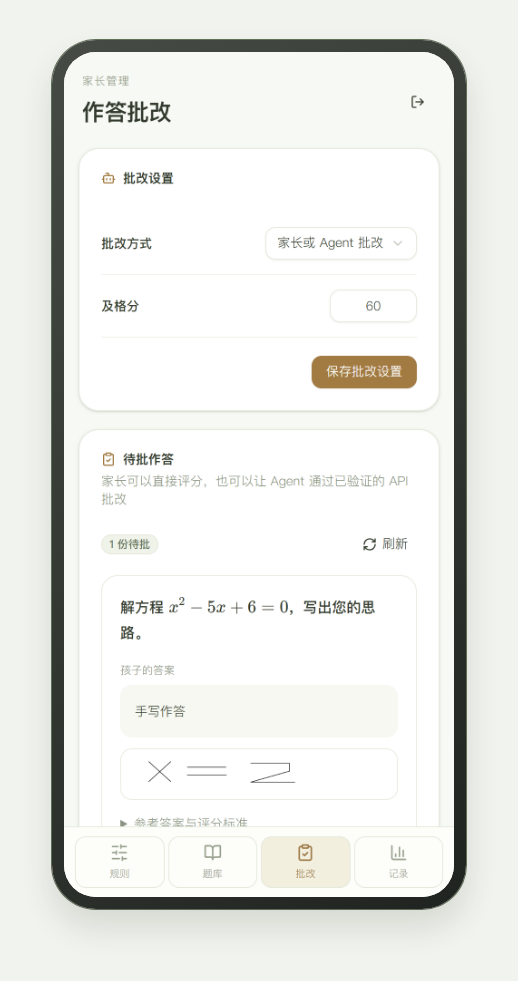
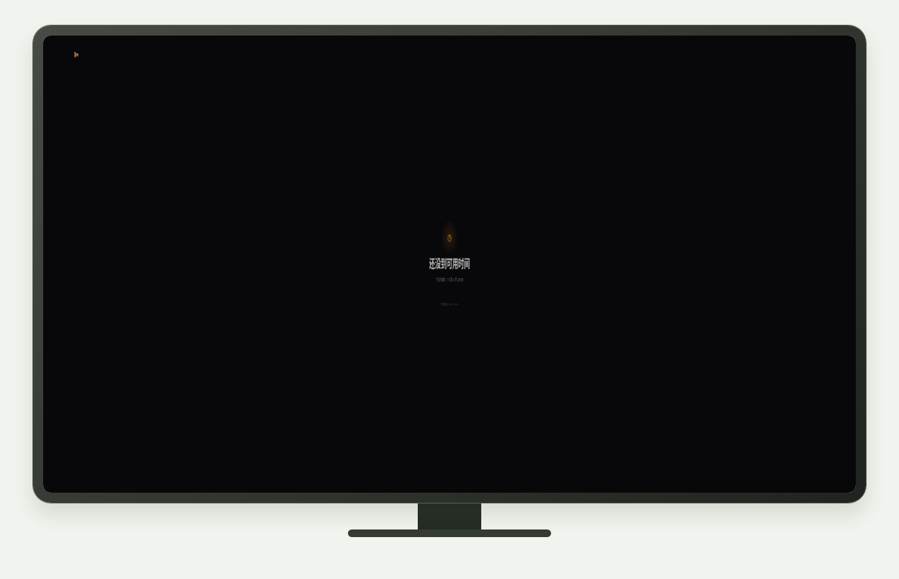
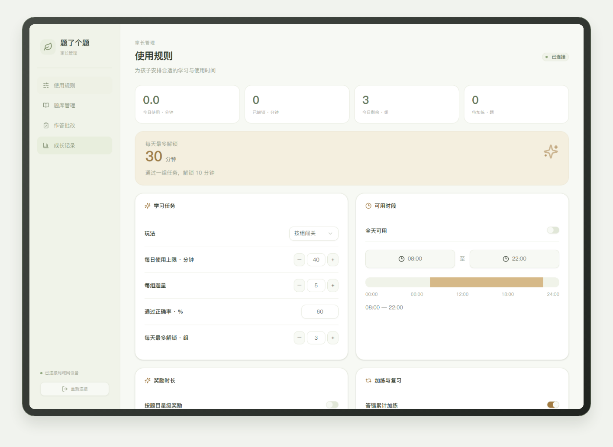

<div align="center">

# 题了个题 · 平板 / 手机 / TV

### 先学再看 · 让每一点进步被看见

**Learn first. Watch later.** · Android 平板优先，兼容手机和电视，不需要自建服务器

本项目已链接并认可 [LINUX DO](https://linux.do) 社区。

[](https://github.com/chadyi/StudyOnTV/stargazers)
[](https://github.com/chadyi/StudyOnTV/releases/latest)
[](https://github.com/chadyi/StudyOnTV)
[](./LICENSE)

</div>

---

## 安装

Android 平板、手机和电视使用同一套规则，分别安装对应版本：

- **[手机 / 平板版](https://github.com/chadyi/StudyOnTV/releases/download/v0.2.0/StudyOnTV-Mobile-v0.2.0.apk)**
- **[TV 版](https://github.com/chadyi/StudyOnTV/releases/download/v0.2.0/StudyOnTV-Android-TV-v0.2.0.apk)**

手机和平板直接下载安装；电视可通过 U 盘或 ADB 安装。首次打开设置管理密码并开启所需权限。

👉 **[安装指南 → docs/install.md](./docs/install.md)**

---

## 它能做什么

孩子先完成学习任务，再解锁设备使用时间，到时显示新的学习任务。平板和手机支持触屏、公式、语音输入与手写，电视支持遥控器。题库、规则、使用记录和加练池都保存在被控设备。

- **开放题型**：单选、多选、判断、填空、主观题；题干和选项支持 LaTeX 公式，离线显示。
- **多种玩法**：按组闯关、连续答对、自由练习，可设置正确率、任务数量和可用时段。
- **星级奖励**：1–5 星题目分别设置时长奖励，仍受每日上限约束。
- **累计加练**：答错达到阈值就增加加练题，跨天、重启保留，答对加练题逐道扣除。
- **主观题批改**：家长手动批改、WorkBuddy / Codex 等 Agent 批改，或配置 DeepSeek 等兼容 AI API。
- **间隔重复**：在规则里打开后，优先复习到期题，答对后延长间隔，答错后提前复习，进度跨重启保留。
- **密码管理**：首次设置管理密码，扫码面板和 API 都要验证。标题连点 5 次或遥控器「上」短按 5 次，可重新打开家长验证入口。

[玩法说明](./docs/gameplay.md) · [题库与批改 API](./docs/ai-api.md) · [示例题库](./data/banks/open-play.json)

管理页面由被控设备在局域网内提供。离线题目直接在设备上完成；AI 批改需要网络和家长配置的服务。

---

## 截图

<div align="center">

<br><sub>平板学习 · 公式、文字与手写作答</sub><br><br>
<br><sub>手写过程可提交家长、Agent 或图像模型批改</sub><br><br>
<br><sub>手机学习 · 与平板共用题库和规则</sub><br><br>
<br><sub>家长批改与 AI 设置</sub><br><br>

<br><sub>遥控器选题，答错直接显示正确答案</sub>

<br><br>


<br><sub>家长扫码，手机和电视同一个 WiFi 即可</sub>

<br><br>


<br><sub>未到可用时段时停留提示页，显示下次可用日期和时间</sub>

<br><br>

<table><tr>
<td align="center"><br><sub>规则设置</sub></td>
<td align="center"><br><sub>题库管理</sub></td>
<td align="center"><br><sub>7天使用记录</sub></td>
</tr></table>

<br><sub>电脑管理 · 规则、题库、批改与学习记录</sub>

</div>

---

## 家长能设置什么

| 设置项 | 说明 |
|---|---|
| 每天最多看 | 超出后当天锁死，第二天重置 |
| 每次答题解锁 | 一组题答完解锁几分钟 |
| 每组题量 | 一组几道题 |
| 答对比例 | 答对多少题才算通过（百分比） |
| 每天最多答几组 | 答完上限即锁定 |
| 可用时段 | 独立「全天可用」开关；指定时段支持跨午夜 |
| 间隔重复 | 开启后优先抽取到期复习题，再补新题 |
| 玩法 | 按组闯关、连续答对、自由练习 |
| 星级奖励 | 分别设置 1–5 星每题奖励 |
| 答错加练 | 累计错误阈值与每次加练题量 |
| 主观题批改 | 家长 / Agent 或 AI API，支持及格分与评分标准 |

---

## 题库

- 手机上新增、删除、即时生效
- **导出 JSON** 发给群里其他家长，对方「导入」一贴即用
- 内置 50 题：唐诗填空、100 以内加减法、英语基础单词
- 让 AI 批量出题：把 [接口说明](./docs/ai-api.md) 发给 WorkBuddy / Codex 等 Agent，让它直接往被控设备里写题

---

## 它是怎么工作的

```
被控设备 App（手机 / 平板包，独立 TV 包）
├── 内置网页：答题 / 锁屏 / 扫码页（离线可用）
├── 内置 HTTP 服务：局域网 8099 端口
└── 本地 SQLite：规则 + 题库 + 事件记录

手机端
└── 扫二维码 → http://<设备IP>:8099/admin/ → 输入管理密码
```

管理密码在首次使用时设置。扫码只打开地址，面板和 API 都需要验证；没有项目自建云端和账号体系。

---

## FAQ

**Q：孩子把 App 强退了怎么办？**
A：需要开启无障碍和后台运行权限。系统强制停止应用、关闭权限或卸载后管控会停止，重新打开时请确认权限。

**Q：支持哪些设备？**
A：Android 5.0+ 的平板、手机和电视。厂商后台限制需要在实际设备上确认，鸿蒙 NEXT / Tizen / webOS 待支持。

**Q：数据会传到网上吗？**
A：题库和记录保存在被控设备。开启 AI 批改后，题目和答案会发送到家长配置的服务；项目中已有的第三方统计配置另见 [统计说明](./docs/analytics.md)。

**Q：更换电视会丢数据吗？**
A：题库可以在手机管理页导出 JSON，换电视后重新导入。

---

## 技术栈

| 层 | 技术 |
|---|---|
| Android 原生 | Kotlin，零第三方依赖 |
| 学习页面 | 原生 ES5 + CSS，兼容老 WebView |
| 手机管理页 | React + shadcn/ui |
| 本地存储 | SQLite（Android 内置） |
| 局域网通信 | Kotlin ServerSocket，HTTP/1.1 |

---

## 社区建议与致谢

感谢 [LINUX DO](https://linux.do) 社区的建议：

- **xiuweng**：支持手机管控、通过隐藏手势重新打开管理入口，以及答错后累计加练、重启保留加练池。
- **free-swimming**：设置题目星级难度，并为不同难度配置不同的时长奖励。

这些建议也延伸到平板端，欢迎继续反馈实际使用体验。

---

## License

源码可查阅，**仅限个人家庭使用**，禁止商业用途和二次分发。欢迎 Issue 反馈问题。

商业授权请通过 [GitHub Issues](https://github.com/chadyi/StudyOnTV/issues) 联系作者。
