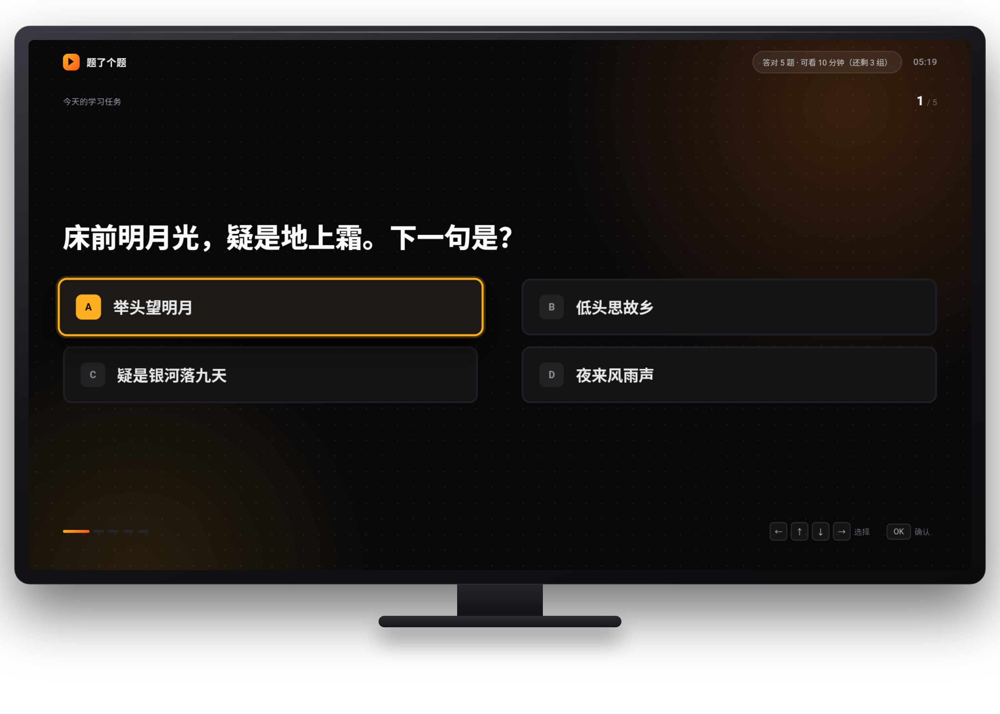
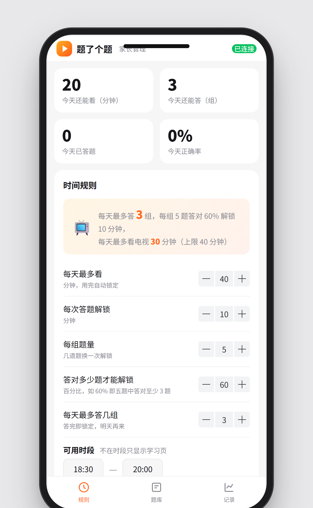
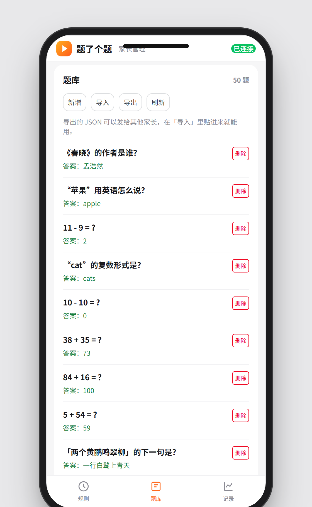
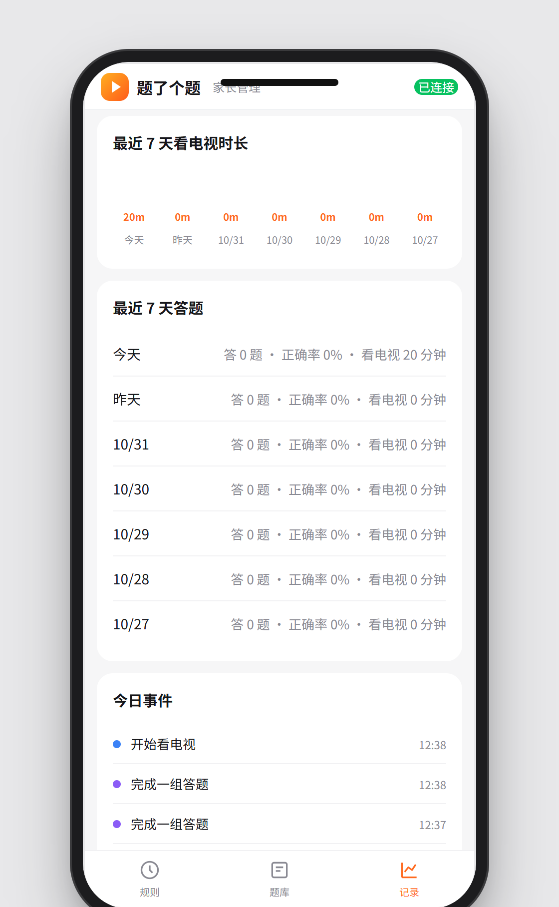

<div align="center">

# 题了个题 TV版

### 先学再看 · 让电视时间更有价值

**Learn first. Watch later.** · 开源 Android TV 应用，不需要服务器、不需要账号

本项目已链接并认可 [LINUX DO](https://linux.do) 社区。

[](https://github.com/chadyi/StudyOnTV/stargazers)
[](https://github.com/chadyi/StudyOnTV/releases/latest)
[](https://github.com/chadyi/StudyOnTV)
[](./LICENSE)

</div>

---

## 先装到电视上

不需要 Root，U 盘或 ADB 装均可。各品牌开 ADB 的位置、装完要开的权限，都在这里：

👉 **[安装指南 → docs/install.md](./docs/install.md)**

---

## 它能做什么

孩子想看电视，先做几道题；答对解锁对应时长，时间到自动锁屏。题目、规则、记录全部存在电视本地，**不联网、不注册、没有服务器**。

| 电视端 | 手机端 |
|---|---|
| 遥控器答题 → 解锁时间 → 到点锁屏 | 扫电视上的二维码，改规则、加题库、查记录 |

手机管理页由电视自己托管，扫码直连，不依赖任何外网。

---

## 截图

<div align="center">


<br><sub>遥控器选题，答错直接显示正确答案</sub>

<br><br>


<br><sub>家长扫码，手机和电视同一个 WiFi 即可</sub>

<br><br>


&nbsp;&nbsp;

<br><sub>每日时间用完 · 单次时间到了需要再答题</sub>

<br><br>

<table><tr>
<td align="center"><br><sub>规则设置</sub></td>
<td align="center"><br><sub>题库管理</sub></td>
<td align="center"><br><sub>7天使用记录</sub></td>
</tr></table>

</div>

---

## 家长能设置什么

| 设置项 | 说明 |
|---|---|
| 每天最多看 | 超出后当天锁死，第二天重置 |
| 每次答题解锁 | 一组题答完解锁几分钟 |
| 每组题量 | 一组几道题 |
| 答对比例 | 答对多少题才算通过（百分比） |
| 每天最多答几组 | 答完上限即锁定 |
| 可用时段 | 不在时段内只显示学习页 |

---

## 题库

- 手机上新增、删除、即时生效
- **导出 JSON** 发给群里其他家长，对方「导入」一贴即用
- 内置 50 题：唐诗填空、100 以内加减法、英语基础单词
- 让 AI 批量出题：把 [接口说明](./docs/ai-api.md) 发给 WorkBuddy / Codex 等 Agent，让它直接往电视里写题

---

## 它是怎么工作的

```
电视 App（一个 APK，约 1 MB）
├── 内置网页：答题 / 锁屏 / 扫码页（离线可用）
├── 内置 HTTP 服务：局域网 8099 端口
└── 本地 SQLite：规则 + 题库 + 事件记录

手机端
└── 扫二维码 → http://<电视IP>:8099/admin/?t=<访问码>
```

访问码 6 位随机数字，只对局域网开放，没有云端、没有账号。

---

## FAQ

**Q：孩子把 App 强退了怎么办？**
A：开启无障碍服务权限后，App 会监控前台应用，切出去会重新弹回来。

**Q：支持哪些设备？**
A：Android TV 5.0+（minSdk 21），小米电视、索尼、飞利浦、海信、创维等主流品牌均可。鸿蒙 TV / Tizen / webOS 待支持。

**Q：数据会传到网上吗？**
A：不会。所有数据只存在电视本地的 SQLite 里，HTTP 服务只监听局域网。

**Q：更换电视会丢数据吗？**
A：题库可以在手机管理页导出 JSON，换电视后重新导入。

---

## 技术栈

| 层 | 技术 |
|---|---|
| Android 原生 | Kotlin，零第三方依赖 |
| 电视端网页 | 原生 ES5 + CSS，兼容老 WebView |
| 手机管理页 | Vue 3 + Vant 4（CDN 引入） |
| 本地存储 | SQLite（Android 内置） |
| 局域网通信 | Kotlin ServerSocket，HTTP/1.1 |

---

## License

源码可查阅，**仅限个人家庭使用**，禁止商业用途和二次分发。欢迎 Issue 反馈问题。

商业授权请通过 [GitHub Issues](https://github.com/chadyi/StudyOnTV/issues) 联系作者。
